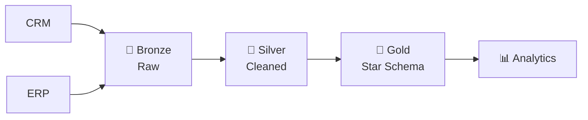

# BikeSales

An end-to-end data engineering project that builds a data pipeline in **Databricks** using the **Medallion Architecture (Bronze → Silver → Gold)**. Bike sales data from **CRM** and **ERP** systems is ingested, cleaned and modeled into a star schema for analytics.

## 🏗️ Architecture

## 📂 Data Sources
- **CRM:** Sales, Customers, Product details
- **ERP:** Customer attributes, Location, Category data

## 🥉🥈🥇 Layers
| Layer | Description |
|-------|-------------|
| **Bronze** | Raw data loaded as-is from CRM & ERP |
| **Silver** | Cleaned, deduplicated, standardized and type-corrected data |
| **Gold** | Business-ready star schema: `dim_customers`, `dim_products`, `fact_sales` |

## 🛠️ Tech Stack
Databricks · PySpark · Spark SQL · Delta Lake · GitHub

## ▶️ How to Run
1. Clone the repo and import it into Databricks (Git folders).
2. Upload the source CSV files.
3. Run notebooks in order: `Bronze` → `Silver` → `Gold`.

